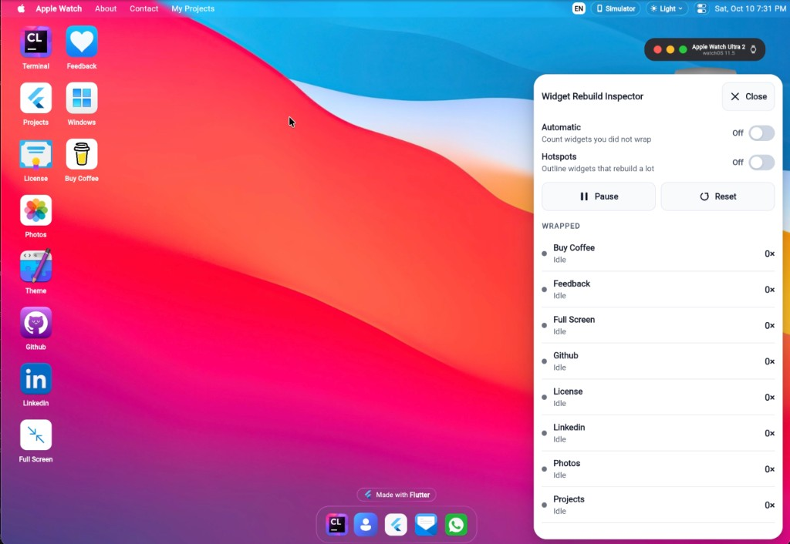
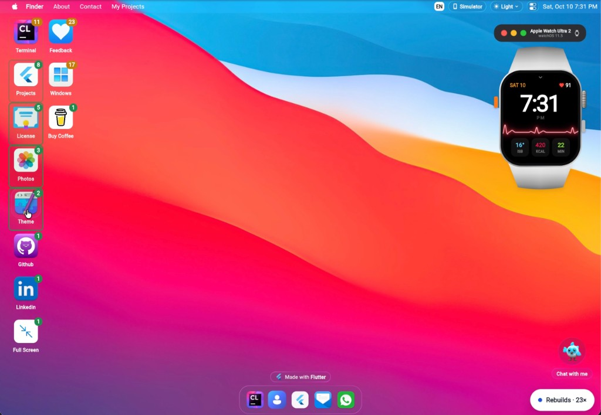

# widget_rebuilds_inspector

A debug overlay that shows which widgets rebuilt, how often, and whether the parent or the child caused it.

<p align="center">
  
</p>

<p align="center">
  
</p>

<p align="center">
  The open panel, then the chip with outlines on the widgets that rebuilt.
</p>

The badge and the flash sit on the widget while you use the app. A `const` child that Flutter skips stays still, so you can see when a refactor worked. Counts are diagnostics: a high number does not mean the frame was expensive.

## What a row means

| Cause | What it means |
| --- | --- |
| Initial build | The widget mounted. |
| Parent rebuild | An ancestor passed a new widget into this slot. |
| Child rebuild | This widget rebuilt itself, usually from `setState` or an inherited dependency. |

A nested `setState` belongs to the widget that owns that state. Wrap that widget, or turn **Automatic** on, to see it.

## The panel

The panel is fixed at the bottom right. The chip shows the busiest count, such as `Rebuilds · 4×`.

- **Automatic** counts widgets you did not wrap. It stays off until you turn it on.
- **Hotspots** outlines widgets that rebuild a lot. Full-screen pages are skipped.
- **Pause** freezes the counts until you resume.
- **Reset** clears the live counts and keeps the baseline.
- **RAM** is this process, about once a second. **Storage** is files this app has saved. Both are hidden on web.

The panel does not count its own rebuilds. A RAM number that moves a little on a quiet screen is the engine and the collector. A leak is a floor that climbs and stays up.

## Frequency

The busier signal wins: total builds, or builds per second over 3 seconds.

| | Moderate | Frequent |
| --- | ---: | ---: |
| Builds this session | 10 | 40 |
| Builds per second | 4 | 10 |

31 builds across a session is Moderate. 47 is Frequent. A short burst can reach Frequent on rate first.

Later rebuilds in **Automatic** are grouped by widget type. The first mount is skipped, and common layout and Material widgets are hidden. DevTools **Track Widget Rebuilds** uses the same Flutter callback. When DevTools owns it, the panel says automatic detection is paused, and parent-driven counts on wrapped widgets still update.

The package does not measure paint, layout, or frame time. The flash is a short repaint, and that repaint is not added to the count.

## Install

```yaml
dependencies:
  widget_rebuilds_inspector: ^1.0.0
```

Flutter `>=3.38.0`. In release the wrapper returns `child` and does not install a hook.

## Add the overlay

Put the inspector above the app. `enabled` follows `kDebugMode`, so a release build shows the child alone.

```dart
import 'package:flutter/foundation.dart';
import 'package:flutter/material.dart';
import 'package:widget_rebuilds_inspector/widget_rebuilds_inspector.dart';

class MyApp extends StatelessWidget {
  const MyApp({super.key});

  @override
  Widget build(BuildContext context) {
    return MaterialApp(
      builder: (context, child) {
        return WidgetRebuildInspector(
          enabled: kDebugMode,
          child: child ?? const SizedBox.shrink(),
        );
      },
      home: const InboxPage(),
    );
  }
}
```

## Name the widgets

`showCounter` and `highlightRebuilds` default to true. The badge is painted on top of the child, so it does not change layout.

```dart
Column(
  children: [
    RebuildInspector(name: 'ProfileHeader', child: ProfileHeader()),
    RebuildInspector(name: 'UserInformation', child: UserInformation()),
    RebuildInspector(name: 'NotificationCounter', child: NotificationCounter()),
    RebuildInspector(name: 'RecentActivity', child: RecentActivity()),
  ],
)
```

An identical child is skipped. A `const` widget that Flutter does not rebuild leaves the counter still:

```dart
RebuildInspector(
  name: 'Frozen',
  child: const ProfileHeader(),
)
```

## Compare a change

Mark a baseline, repeat the same gesture, then read the delta. `reset()` clears the live counts and leaves the baseline in place. `exportJson()` is the same report as `exportMarkdown()`. `clearBaseline()` drops the snapshot.

```dart
final inspector = RebuildInspectorController.instance;

inspector.markBaseline('Before const split');
// Repeat the same gesture.
final comparison = inspector.compareToBaseline();
debugPrint(inspector.exportMarkdown());
```

## Change the bands

Pass `RebuildThresholds` when the defaults are too strict or too loose for the screen you are watching. `onFrequentRebuild` runs once, when a row first becomes Frequent.

```dart
WidgetRebuildInspector(
  enabled: kDebugMode,
  thresholds: const RebuildThresholds(
    moderateAfter: 20,
    frequentAfter: 60,
    moderatePerSecond: 5,
    frequentPerSecond: 12,
  ),
  onFrequentRebuild: (stats) {
    debugPrint('${stats.name} is rebuilding a lot');
  },
  child: child ?? const SizedBox.shrink(),
)
```

## Start with automatic detection

The panel switch does the same thing. `userWidgetsOnly` keeps widgets created in your app, and `ignoreCommonWidgets` hides types such as `Padding`, `Column`, and `Text`.

```dart
WidgetRebuildInspector(
  enabled: kDebugMode,
  automaticTracking: true,
  userWidgetsOnly: true,
  ignoreCommonWidgets: true,
  child: child ?? const SizedBox.shrink(),
)
```

## Example

```sh
cd example
flutter run
```

**Simulate parent rebuild** refreshes every non-const section. **Add notification** and **Burst updates** refresh one section.

## Reference

### `WidgetRebuildInspector`

| Parameter | Default | |
| --- | --- | --- |
| `enabled` | `kDebugMode` | `false` returns `child` with no hook and no panel. |
| `showOverlay` | `true` | Paints the panel. |
| `initiallyExpanded` | `false` | Starts open instead of on the chip. |
| `automaticTracking` | `false` | Records widgets you did not wrap. |
| `userWidgetsOnly` | `true` | Keeps widgets created in the app. |
| `ignoreCommonWidgets` | `true` | Hides common framework widgets. |
| `highlightHotspots` | `false` | Outlines frequent detected widgets. |
| `thresholds` | `RebuildThresholds()` | Count and rate cutoffs. |
| `controller` | owned | Use your own for baseline and export. |
| `onFrequentRebuild` | | Called the first time a row becomes Frequent. |

### `RebuildInspector`

| Parameter | Default | |
| --- | --- | --- |
| `name` | required | Label on the badge, the panel, and the export. |
| `child` | required | The widget to count. |
| `showCounter` | `true` | Paints the count. |
| `highlightRebuilds` | `true` | Flashes the bounds after the first mount. |
| `highlightColor` | band color | Overrides Low, Moderate, and Frequent. |
| `location` | | Extra label stored on the report row. |
| `enabled` | inherited | Overrides the scope, then `kDebugMode`. |
| `controller` | inherited | Overrides the nearest inspector. |
